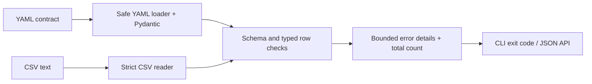

# Data Contract Gate

An offline Python quality gate for CSV datasets. A versioned YAML contract defines expected columns, types, uniqueness, numeric bounds, allowed values and patterns. The same validation engine serves a CLI, CI and FastAPI, with deterministic JSON diagnostics that do not echo cell values.

## Try the passing and failing datasets

```bash
uv sync --frozen --group dev
uv run contract-gate examples/orders.yml examples/valid.csv
uv run contract-gate examples/orders.yml examples/invalid.csv
uv run pytest -q
uv run uvicorn contractgate.api:app --reload
```

The valid synthetic order file passes. The invalid file produces five errors: duplicate order ID, negative total, unsupported currency, invalid calendar date and malformed customer code.

## Architecture



There are no paid APIs, model downloads or remote data transfers.

## Contract dialect

```yaml
name: orders-v1
min_rows: 1
max_rows: 1000
allow_extra_columns: false
columns:
  order_id:
    type: integer
    unique: true
    min: 1
  total:
    type: decimal
    min: 0
  currency:
    allowed: [EUR, USD]
  ordered_on:
    type: date
```

- All declared columns are required. Unexpected columns fail unless explicitly allowed. Duplicate headers fail before data checking.
- Types: `string`, `integer`, `decimal`, `date` (strict `YYYY-MM-DD` plus calendar validity). Decimal checks use finite `Decimal`, not floats.
- Empty CSV fields are null. They fail unless `nullable: true`; nullable nulls are skipped for all other checks, including uniqueness. Empty strings and null are not distinguished.
- `unique` compares parsed typed values: integer `01` and `1` collide; strings remain exact.
- `min`/`max` are inclusive numeric bounds. `allowed` compares raw cell text. `pattern` uses Python `re.fullmatch` on raw cell text. Whitespace is not automatically trimmed; integer grammar rejects it, while Python's Decimal parser may accept surrounding whitespace.
- Unknown contract keys, duplicate YAML mapping keys, unsupported types, malformed regexes, inverted bounds and non-finite bounds are rejected.
- UTF-8 BOM, quoted commas and multiline fields are supported. Error `record` refers to the logical CSV record, counting the header as 1, not the physical line number.

No automatic coercion, dropping, repair or mutation of source data occurs.

## Output and quality-gate behavior

```json
{
  "contract": "orders-v1",
  "passed": false,
  "rows_checked": 2,
  "error_count": 1,
  "errors": [{"code":"duplicate_value","record":3,"column":"order_id"}],
  "details_truncated": false
}
```

The default report retains at most 100 error details while counting all detected errors in inspected records. Malformed CSV or duplicate headers prevent complete row inspection. The Python CSV parser also enforces its default per-field size limit. The hard limit is 100,000 data records (one extra record may be counted when detecting the limit) and 1,000,000 CSV characters. Uniqueness uses memory proportional to distinct values.

CLI exit codes: `0` pass, `1` data quality failure, `2` invalid contract, unreadable/oversized file or invalid encoding. JSON goes to stdout; invalid-input diagnostics go to stderr. This makes the CLI usable as a CI step:

```yaml
- run: uv run contract-gate examples/orders.yml examples/valid.csv
```

The repository's own CI validates lint/formatting and runs tests on Python 3.11, 3.12 and 3.13 with the committed lockfile.

## API and local container

`POST /validate` accepts a JSON object with `contract` (the parsed contract object) and `csv` (CSV text). Valid requests return HTTP 200 with `passed`; invalid contracts return HTTP 422. Explore http://127.0.0.1:8000/docs. `GET /health` checks liveness.

```bash
docker build -t data-contract-gate .
docker run --rm -p 127.0.0.1:8000:8000 data-contract-gate
```

The container runs as a non-root user. The container build is optional; CI exercises Python directly.

## Limits

This is an educational portfolio demo, not an implementation of an external contract standard or a managed data platform. No warehouse connector, lineage system, schema migration, authentication or deployment is included. It does not establish business correctness or detect every data issue.

Use trusted local contracts and synthetic data only. Python regular expressions are not sandboxed; pathological patterns can consume excessive CPU. The text/row limits are not a substitute for ingress request-size/time limits, and the API does not implement those controls. Error details omit cell values but still reveal contract and column names. For real sensitive datasets, add authorization, retention policy and operational controls before deployment.
